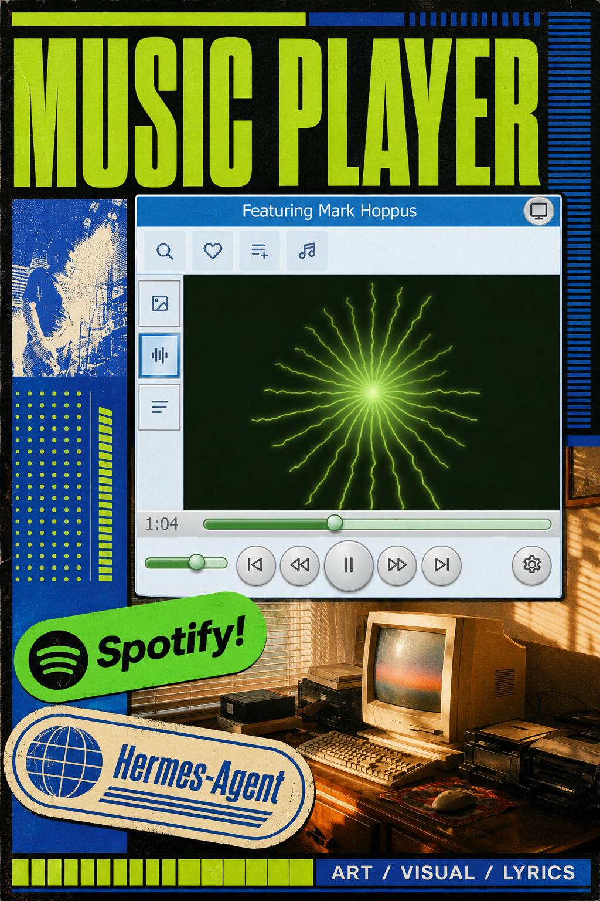
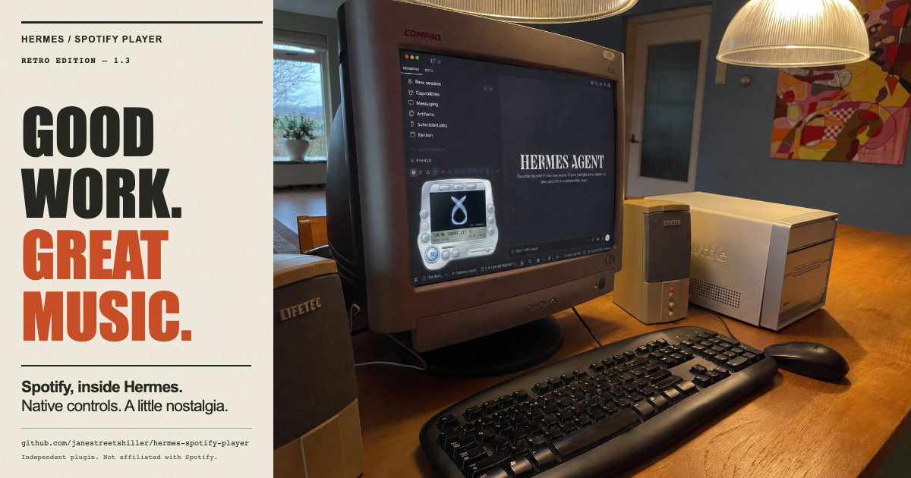

# Hermes Spotify Player — social plan and assets

## Music Player flyer campaign

[Download the unchanged flyer](media/music-player-neon-flyer.png) · [Asset provenance](DESIGN-SOURCES.md#additional-music-player-flyer)

Status: prepared locally; not pushed, scheduled or posted. This flyer supplements the existing artwork. The master is a 1024×1536 PNG; preserve the full composition. If a publishing interface requires another shape, request a separate padded export rather than cropping the headline, badges or footer. No derivative was generated for this task.

### Message and audience

Lead with the player: a retro music pocket beside your Hermes work. Aim at Hermes users on macOS, open-source desktop tinkerers and people who miss old media players. The poster catches attention; a real, clearly labeled product demo should answer what works.

Primary action: visit the repository and read the install requirements. Secondary action: tell us which player view or playlist workflow you would use. Avoid generic engagement bait and promises of perfect mood matching.

Repository: https://github.com/janestreetshiller/hermes-spotify-player

### Seven-day rollout

Day 0 means the owner-approved publication day, not an automatically scheduled date. Use the account's own audience data for posting time; no universal best-time claim.

| Day | Channel and asset | Post / action | Readout |
|---|---|---|---|
| 0 | X and Bluesky; unchanged flyer | Use the short caption below and the repository link. Upload the full image and alt text. | Record impressions and link clicks where the platform exposes them; collect install questions. |
| 1 | Instagram feed; flyer | Use the visual-first caption. Preview the full composition before publishing; use the repository link in the profile or an available explicit link surface. | Saves, shares and substantive comments. |
| 2 | One relevant Hermes community channel; flyer plus repository link | Use the community caption, after checking that channel's self-promotion rules. Reply to setup questions rather than repeating the launch post. | Setup successes/blockers reported by users, with no invented adoption figures. |
| 4 | X/Bluesky follow-up; a short real UI capture | Show quiz → editable tracklist → inline song details. Label dry-run/fixture data. Use the skills caption only once the installable skill revision is publicly available and checked. | Questions about the workflow and clicks to the actual skill-install instructions. |
| 6 | Original thread or community post; text reply | Answer the most common genuine question and summarize known limitations. Link an actual fix or issue if one exists. | Unresolved setup blockers; compare with Day 0. |

The Day 4 capture is planned content, not an asset produced here. Do not pass the flyer off as a runtime screenshot, or put copyrighted commercial audio under a clip without the necessary permission. A silent captioned capture is enough. Do not spend on paid promotion until installation and account setup have been checked by intended users.

### Ready-to-use captions

#### X / Bluesky

A retro music pocket for your agent desktop. Hermes Spotify Player brings playback controls, artwork and lyrics beside your work on macOS.

Code + setup: https://github.com/janestreetshiller/hermes-spotify-player

Independent plugin; not affiliated with Spotify.

#### Instagram

The music player gets its own flyer.

Hermes Spotify Player puts a little retro desktop hardware beside your work: playback controls, artwork and lyrics in Hermes on macOS. The image is promotional artwork; the repository has the actual feature list and setup instructions.

Which view would you leave open: artwork or lyrics?

Code and setup via the repository link in the profile. Independent plugin; not affiliated with Spotify.

Optional tags: #HermesAgent #OpenSource #DesktopCustomization

#### Hermes community / Discord

A new flyer for Hermes Spotify Player, the open-source macOS player pocket for Hermes Desktop.

The player controls your signed-in Spotify app locally. Search, likes and playlist actions use your own Spotify developer app and the active Hermes profile's OAuth connection. Start with the repository's requirements and tested install revision rather than assuming the default branch includes every candidate feature.

https://github.com/janestreetshiller/hermes-spotify-player

If you try it, share your Hermes/macOS versions and any setup blocker. Please leave tokens, private playlists and unrelated desktop content out of screenshots. Independent plugin; not affiliated with Spotify.

#### Skills follow-up — hold until the revision is public

Pick the mood before the songs.

/my-mix, /new-tracks and /my-favorites turn a short quiz into a playlist draft you can reorder. Inspect songs inside Hermes. Approve before saving a private playlist.

Code + setup: https://github.com/janestreetshiller/hermes-spotify-player

Before posting, replace the generic link with the verified public skill-install section if the default branch still lacks the pack. Do not describe locally committed work as downloadable from a release that does not include it.

### Alt text

“Portrait Music Player flyer in neon yellow-green, cobalt and black. A silver player with a radial visualizer overlaps a sunlit retro computer desk. Spotify and Hermes-Agent badges cross the lower half. The player title bar reads ‘Featuring Mark Hoppus’; the footer reads ‘ART / VISUAL / LYRICS.’ This is promotional artwork.”

### Before publication

- The image includes “Featuring Mark Hoppus.” Confirm the intended meaning and permission to distribute that name/likeness treatment before posting the flyer publicly or using it in ads. Do not claim a collaboration or endorsement, tag the artist as a partner, or rewrite the supplied image without approval. Caption disclaimers do not establish image rights.
- Treat Spotify and Hermes marks as product references, not proof of an official joint release. Keep the independent-plugin disclosure in captions.
- The remote default branch is `main` and its README differs from this candidate branch. Publish only owner-approved commits, verify the exact public README/asset bytes and linked install instructions, and then use that verified revision in launch copy. Do not merge the full candidate merely to add a flyer.
- Current candidate docs describe optional audio-driven visuals, but the public default README does not list that feature. Show and describe it only against a verified public candidate. Do not reuse the older decorative-visualizer caption below for the current candidate.
- The Mix Desk live test covered real read-only Spotify results, not a live playlist write; see [skill-pack QA](SKILL-PACK-QA.md). Do not claim full end-to-end live creation verification from that dry run.
- Choose the actual posting accounts and obtain publication approval before scheduling or posting. This document does not authorize automated messages, paid ads or social-account changes.

### Measurement note

Keep a small manual log per post: channel, live post URL, asset revision, impressions, outbound clicks if available, saves/shares, and recurring setup problems. Review at roughly 24 hours and at the end of the rollout. Mark unavailable metrics as unavailable; do not substitute follower counts or fabricated conversion figures. No tracking pixel or analytics script is added to the repository.

## Earlier 1.3 copy and artwork — archive

The material below records earlier campaign drafts and their historical publication notes. It is not the current launch checklist; some feature descriptions predate the current audio visualizers and Mix Desk work.

### Cleanup release caption

Same silver player. A cleaner fit.

Hermes Spotify Player now keeps its frame in proportion across full, screen-off and mini modes, with better-spaced chrome controls and clearer error feedback. Built for the Hermes Desktop sidebar on macOS.

This is a refinement of the original player—not a new historic-player collection. Demo playback is simulated; live account-dependent search, likes and playlist verification still require Spotify authorization. TERMIN8 is a separate project.

### Short post

Good work. Great music.

A little nostalgia for your agent desktop. Hermes Spotify Player brings native playback controls, lyrics and a chrome faceplate into Hermes on macOS. Buttons on the shell. Menus in the screen.

Open source: https://github.com/janestreetshiller/hermes-spotify-player

### Longer caption

Spotify, inside Hermes.

A retro silver player beside your work: play/pause, skip, seek and volume; artwork, lyrics and an ambient visualizer; search and playlist panels inside the display. Default chrome feedback, compact text-only settings, and a heart that checks each song automatically instead of guessing its liked state.

Local playback controls the Spotify macOS app—no embedded web player. Search, likes and playlists require separate Spotify PKCE authorization and applicable account/app access. The live account-dependent flows still await verification; automated integration tests use controlled responses. The visualizer is decorative, not audio-reactive.

Code: https://github.com/janestreetshiller/hermes-spotify-player
Demo: https://janestreetshiller.github.io/hermes-spotify-player/demo/

Independent open-source plugin. Not affiliated with Spotify.

### Artwork and exports

- [Portrait poster](media/retro-poster.png): 1080×1350, 4:5 feed/poster layout.
- [Landscape social card](media/retro-social.png): 1200×630, link-sharing layout.
- [Editable HTML composition](media/retro-poster.html).
- [Original user-supplied base](media/retro-poster-base.png), preserved byte-for-byte.
- [Current UI demo video](media/player-1.3-demo.mp4): silent recording of production UI through the demo adapter, with simulated playback.

The supplied base is the user's retro Compaq desk artwork. It is **concept art**, not proof of supported hardware or a live Spotify session. No product controls were generated or replaced in the artwork. Cream paper, condensed type, orange ink and a subtle print texture frame the original image; the computer scene is not cropped.

Alt text: “Good work. Great music. Hermes Spotify Player poster on cream paper with orange and black condensed lettering. A Compaq CRT shows Hermes and a silver player, surrounded by beige speakers, a computer and a keyboard on a warm wooden desk.”

Rebuild from the repository root with `npm run poster:render`. The renderer uses local assets and checks image decoding, page errors, bounds and content separation. Typography uses Impact when installed (macOS render); other systems may use the declared fallback. Committed PNGs are the canonical exports.

Automation: `Spotify player marketing assets` builds the production-rendered fixture demo, video and poster and uploads a reviewable artifact on relevant pushes or manual dispatch. It does not post to a social account.

Publication status: assets and copy included in the repository and PR. Not posted to any social account; no destination/account was specified. GitHub Pages is already configured to publish `/docs` from `feat/low-resource-nokie-player`; the live social image and demo HTML were fetched and matched these committed files.
